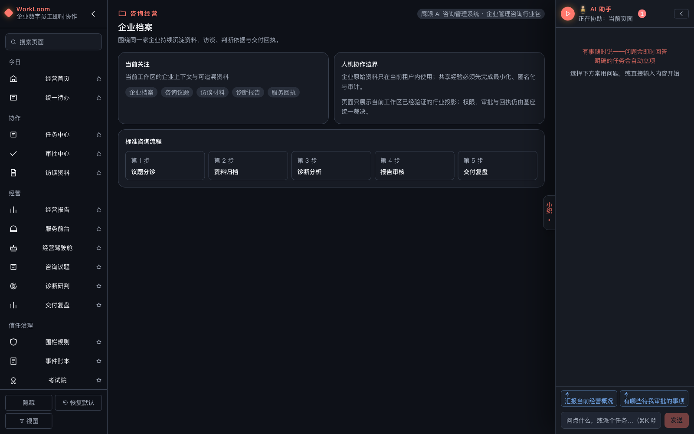
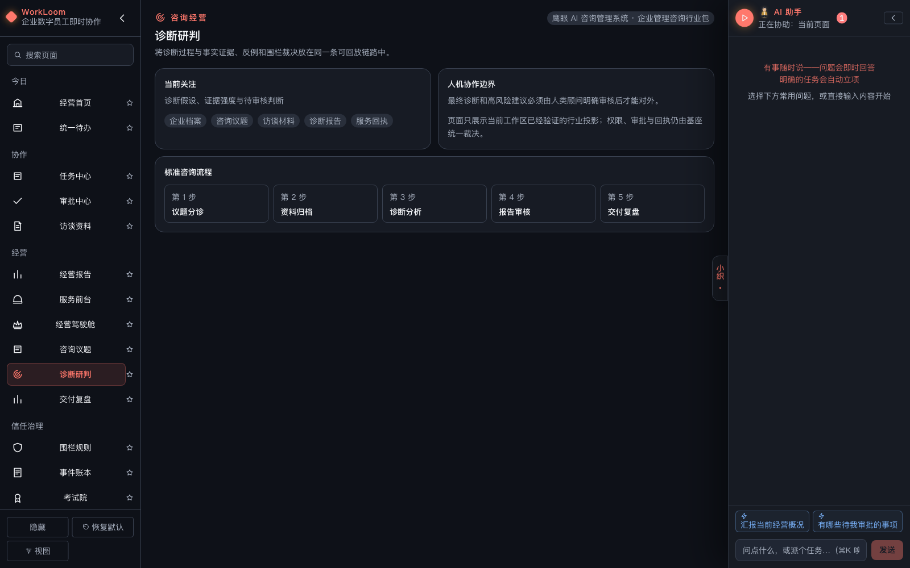
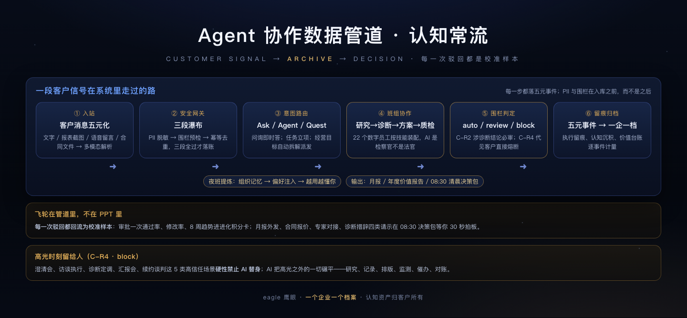

# 鹰眼 Eagle · AI 咨询管理系统

**给咨询工作室、企业顾问和项目团队的持续服务工作台。** 鹰眼把企业资料、诊断依据、交付和后续行动汇在同一份「一企一档」。数字员工可以整理资料、查找信息、起草方案和跟踪行动。关键访谈、正式诊断和高风险建议由人类顾问判断。

[English](README_EN.md) · [咨询行业包](bundles/consulting) · [仓库 Agent 指引](AGENTS.md)

## 从一次咨询到持续服务

1. **收集资料和问题。** 客户在服务前台提交资料、提问或发起工单，项目团队在工作台处理。
2. **形成诊断与方案。** 研究、诊断、方案和质检分工协作，顾问看依据并作关键判断。
3. **交付后继续跟进。** 把结论、承诺和行动记录回企业档案，后续报告可以追溯变化和出处。

## 工作台预览

下图沿用仓库现有的鹰眼咨询所演示数据。

| 客户档案 | 诊断研判 |
| --- | --- |
|  |  |

## 架构与数据流

[WorkLoom IM](https://github.com/geniusdapeng-collab/workloom-im) 提供共享工作区、任务、审批和事件记录，[咨询行业包](bundles/consulting) 定义咨询岗位、规则和企业档案。客户输入经工作区路由进入问询、协作或任务流程，跨阶段判断有审批和事件留痕。

[系统架构图](docs/images/eagle/architecture.png) · [三端业务流程图](docs/images/eagle/user-journey.svg) · [服务类型矩阵](docs/images/eagle/service-matrix.svg)

## 本地演示

在独立环境准备 Node.js 24、仓库声明的 pnpm 和 Docker，执行 `pnpm setup && pnpm preview:all`。按启动提示打开 PC 工作台、移动工作台或客户服务前台。演示使用模拟企业资料。 [预览清单](PREVIEW_CHECKLIST.md) · [演示数据](mock/README.md)

## 源码入口

| 路径 | 可以看到什么 |
| --- | --- |
| [咨询领域包](bundles/consulting) | 岗位、围栏、技能、对象与服务配置 |
| [咨询演示种子](scripts/seed-consulting.ts) | 示例档案和工单 |
| [客户前台](apps/webc) | 资料提交、咨询问答与工单入口 |

## 桌面 Agent 接入（Codex / DeepSeek Harness）

本仓内置桌面 Agent 入口：`node scripts/workloom-agent.mjs list`（能力清单）与
`node scripts/workloom-agent-mcp.mjs`（stdio MCP）。接入步骤、本仓可用能力与安全边界见
[`docs/AGENT-CLIENTS.md`](docs/AGENT-CLIENTS.md)。

<!-- WORKLOOM-AUTONOMOUS-OPERATIONS:BEGIN -->
## 🧭 理论纲领 · AI 自主经营模式

> **客户购买的不是工具，而是一家正在运行的公司。**
> 本仓是 WorkLoom「AI 自主经营」体系的一部分；完整纲领《AI 自主经营纲领——论一个新经营范式的诞生》见 **[AI-AUTONOMOUS-OPERATIONS.md](AI-AUTONOMOUS-OPERATIONS.md)**。

- **成本结构翻转**：人类公司的管理动作，是为"人不可靠"支付的三种对冲税（激励 / 层级 / 监督）；AI 自治退掉这笔税，转而为 **边界定义 + 持续评测** 付费。
- **三个翻转**：管理对象从动机 → **边界**；经营动作从传递信息 → **分配注意力**；行业 knowhow 从"人在经验在" → **可计量资产**。
- **责任不可自动化**：AI 不能坐牢、不能赔钱。围栏 / 人审 / 汇报 / 事件账本构成的治理层，是自治的**对价**，不是限制器。
- **终态判据**：没有客户操作，这件事还会不会发生？"开箱即用"不够——终态是 **没开箱就在运营**：首次登录看到的是已经跑出来的业务进展与第一份汇报。
- **自治权是挣来的**：观察 → 请示后执行 → 汇报后执行 → 全权自治，按决策域用回测证据升降档；汇报透明是自治的价格标签。
- **度量即货币**：自治率、客户干预率、回测命中率三条曲线决定自治权扩张；模拟成功不计入自治率。
<!-- WORKLOOM-AUTONOMOUS-OPERATIONS:END -->

<!-- CAPABILITIES:BEGIN -->
<!-- 本区块由 scripts/generate-capabilities.mjs 自动生成（2026-10-02），请勿手改；重跑 pnpm capabilities 更新 -->

## 🧩 系统能力速览（自动生成 · 与代码同步）

> 以下为源码目录与入口清单；实际调用及结果状态见能力导览的独立证据字段，未验证项不能作交付承诺。

- 🖥 **三端应用入口**：PC 端 · B 端工作台 · 移动端 · B 端高保真 · 移动端 · C 端 AI 服务前台
- 🏨 **行业 Bundle（垂直能力包）**：bundles/ai-pm/ · bundles/consulting/ · bundles/hotel/
- 🧑‍💼 **数字员工与数字人（本仓自带）**：数字员工中心（`/agents`） · 织伴数字人（Live2D 常驻浮层） · 语音与口型引擎 · Live2D 渲染后端与资产
- 🖐 **操作电脑能力（本仓自带 · 可装生产工作站）**：computer-use 三层感知入口 · HTTP 远程驱动 + MCP server
- 🤖 **AI 自动化引擎（系统内置能力）**：围栏 DSL 引擎 · 技能保鲜环（下行分发） · L2 编排（ASK/QUEST） · 夜班自动运行 · 模型路由 · 五元事件 + RLS 隔离 等 10 项
- ✅ **验证与质量（工程纪律）**：一键安装（bootstrap） · 主测试套件 · 发布门禁 · 五元事件验链 · Agent 能力巡游 · 环境自检
- 🎁 **演示与交付资产**：高保真演示页 ×6 · 官网静态站 · 自带技能 ×5 · 能力导览 PPT · Mock 数据体系

> 📖 完整能力导览（含截图与体验路径）：[docs/capabilities.auto.md](docs/capabilities.auto.md) ｜ 🤖 AI Agent 入口：[AGENTS.md](AGENTS.md) ｜ 🎯 首启必跑：`pnpm preview:all`
<!-- CAPABILITIES:END -->

## 许可

[Apache-2.0](LICENSE) · [原版 README](https://github.com/geniusdapeng-collab/workroom-eagle/blob/4d197350318c36b6b352699fe7f65e04454b4ba4/README.md)
