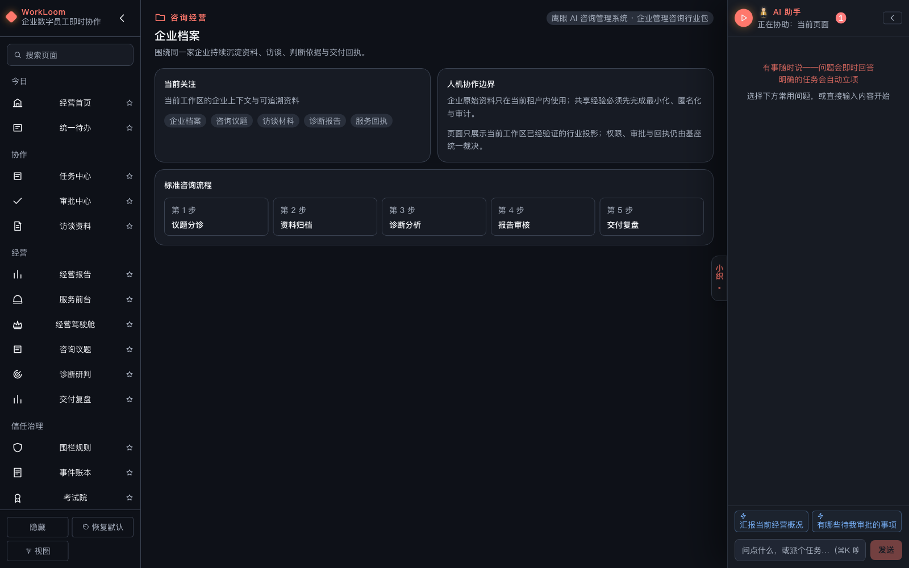

# Eagle · AI Consulting Workspace

**Eagle helps consulting teams keep client context from intake through follow-up.** Each company has a case file for evidence, findings, deliverables, and open actions. Digital staff assist with research, drafting, and tracking. Human consultants lead key interviews, final diagnoses, and sensitive recommendations.

[简体中文](README.md) · [Consulting bundle](bundles/consulting) · [Agent setup](docs/AGENT-CLIENTS.md)

## A typical engagement

1. The client asks a question, shares material, or opens a ticket in the service front.
2. The team gathers evidence, drafts recommendations, and reviews the findings with a consultant.
3. The team records the deliverable and follows up on actions in the company case file.



## Architecture and demo

[WorkLoom IM](https://github.com/geniusdapeng-collab/workloom-im) provides the workspace, task runtime, approvals, and event ledger. The [consulting bundle](bundles/consulting) defines the consulting roles, rules, and client record. [System architecture](docs/images/eagle/architecture.png) · [Agent data flow](docs/images/eagle/data-pipeline.png)

Use a fresh environment with Node.js 24, the repository's declared pnpm, and Docker. The local demo uses simulated consulting records.

## Quick start (fully simulated runtime)

```bash
pnpm setup && pnpm preview:all
```

| Surface | URL | What you see |
|---|---|---|
| PC workbench | http://localhost:3000 | Eagle Consulting ops theater: chief-of-staff morning brief, 12-employee satellite group, pending decisions, live digital office |
| Mobile B | http://localhost:3001 | Hi-fi demo pages |
| Mobile C (client front) | http://localhost:3002 | Consulting service front: monthly-report Q&A, screenshot parsing, urgent escalation |

The demo seed is a full consulting-firm runtime: 3 client archives (Hengchang Machinery · retainer / Chuanyu Taste · diagnosis / Xinglan Tech · audit), 100 five-element events with every C-R fence exercised, night-shift decision package, approval cards and multimodal conversations.

## License

[Apache-2.0](LICENSE) · [Previous README](https://github.com/geniusdapeng-collab/workroom-eagle/blob/4d197350318c36b6b352699fe7f65e04454b4ba4/README_EN.md)
